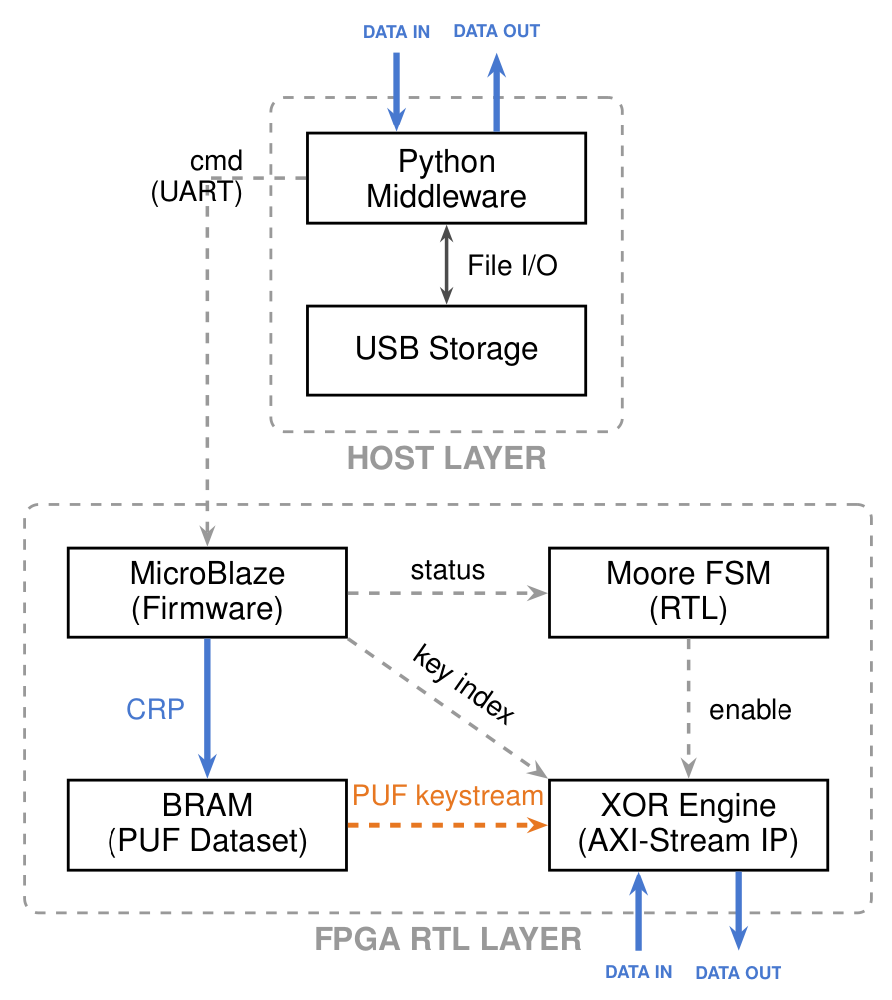
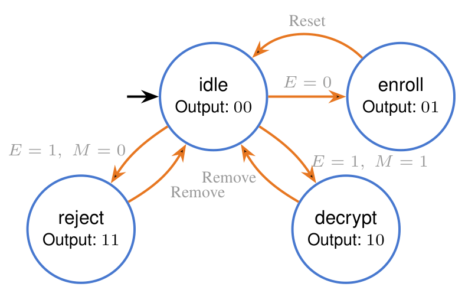
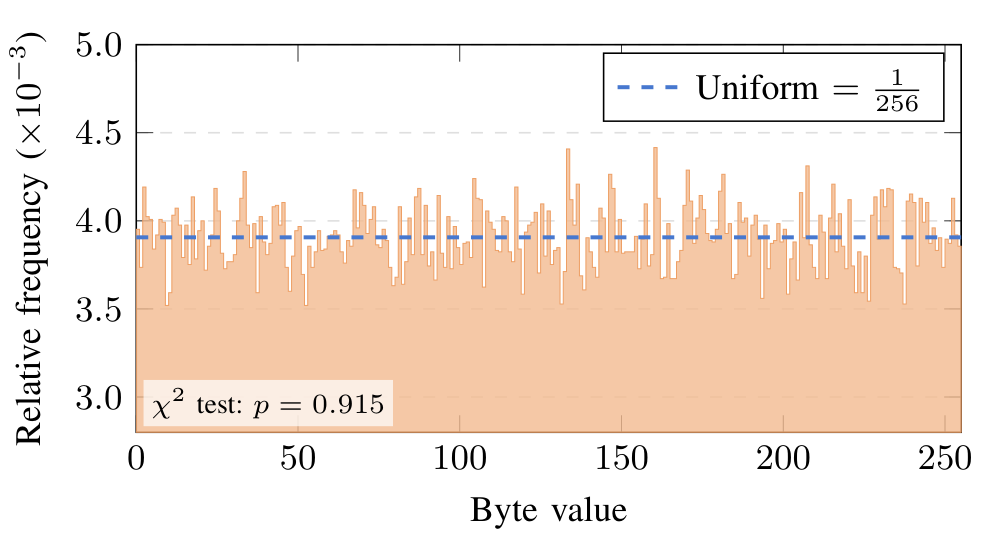

# XorPUF-Mem: Lightweight Memory Obfuscation Using PUF-Based XOR Encryption

An FPGA memory-obfuscation prototype combining a BRAM-backed PUF response table, a hardware XOR datapath, and a MicroBlaze command interface. A Python host sends file data over UART and stores the transformed output.

**Accepted at AEECT** · Qabas Alkaissi, Selen Qarajeh, Jana Falah, and Enas Abulibdeh

Department of Computer Engineering, Princess Sumaya University for Technology, Amman, Jordan

## Overview

The project explores lightweight memory protection on resource-constrained embedded systems. The paper describes an address-derived PUF keystream architecture and demonstrates a USB storage workflow on an Artix-7 FPGA using emulated PUF responses.

The implementation spans three parts:

- **Hardware:** a custom AXI-Stream XOR engine, BRAM response storage, and an RTL policy state machine.
- **Firmware:** a MicroBlaze application that loads the response table, handles enrollment commands, and transfers bytes through the XOR engine.
- **Software:** a Python CLI for file encryption, decryption, and communication with the board.

## System Architecture

<p align="center">
  
</p>

*System architecture from the paper, Fig. 1.*

USB storage connects to the host PC. Python sends commands and data over UART; MicroBlaze moves the data through the FPGA's XOR engine and returns the output. The FPGA does not act as a USB host.

<table align="center">
  <tr><th>Layer</th><th>Main source</th><th>Responsibility</th></tr>
  <tr><td>Hardware</td><td><a href="hardware/rtl/"><code>hardware/rtl/</code></a></td><td>XOR datapath and policy FSM</td></tr>
  <tr><td>Firmware</td><td><a href="firmware/src/main.c"><code>firmware/src/main.c</code></a></td><td>UART commands, response-table loading, and stream transfers</td></tr>
  <tr><td>Software</td><td><a href="host/xorpuf.py"><code>host/xorpuf.py</code></a></td><td>File handling, header validation, and serial communication</td></tr>
</table>

## Obfuscation Datapath

Encryption and decryption use the same XOR operation:

$$ C_i = P_i \oplus K_i, \qquad P_i = C_i \oplus K_i $$

Here, $P_i$ is a plaintext byte, $C_i$ is its ciphertext byte, and $K_i$ is a byte selected from the response table. The counter-based XOR engine addresses BRAM words as:

$$ \text{BRAM address} = 4\left(\left\lfloor\frac{\text{byte count}}{4}\right\rfloor \bmod 100\right) $$

Each 32-bit response supplies four key bytes, selected from most significant to least significant. A reset restarts the stream; a dummy-byte exchange aligns the host with the firmware.

The paper also describes LFSR-based challenge expansion. Experimental LFSR IP is available under [`hardware/experimental/`](hardware/experimental/).

## Enrollment and Authentication

<p align="center">
  
</p>

*Policy state machine from the paper, Fig. 2. E denotes enrollment status and M denotes a signature match in the transition description.*

<table align="center">
  <tr><th>State</th><th>Output</th><th>Intended operation</th></tr>
  <tr><td>Idle</td><td><code>00</code></td><td>Wait for a request</td></tr>
  <tr><td>Enroll / encrypt</td><td><code>01</code></td><td>Establish a session signature and encrypt data</td></tr>
  <tr><td>Decrypt</td><td><code>10</code></td><td>Accept a matching signature and recover plaintext</td></tr>
  <tr><td>Reject</td><td><code>11</code></td><td>Deny a mismatched signature</td></tr>
</table>

The firmware compares a claimed signature against a hash of its compiled response table. The host checks the authentication response before requesting a transfer.

Encrypted files use a 12-byte header followed by ciphertext:

```text
Offset     0              4              8             12
           | PUF1         | Signature    | Byte length  | Ciphertext ...
           | 4 bytes      | 4 bytes      | 4 bytes      |
```

The signature and byte length use big-endian encoding.

## Results

Results reported in the paper are summarized below.

### Ciphertext statistics

The evaluation uses a 1,000,000-bit plaintext constructed from English letter-frequency-weighted sampling.

<table>
  <tr>
    <td width="50%" valign="top">
      <table>
        <tr><th>Metric</th><th>Reported result</th></tr>
        <tr><td>Plaintext Shannon entropy</td><td>4.8442 bits/byte</td></tr>
        <tr><td>Ciphertext Shannon entropy</td><td>7.9987 bits/byte</td></tr>
        <tr><td>Plaintext/ciphertext Pearson correlation</td><td>0.0064</td></tr>
        <tr><td>Byte-distribution chi-square p-value</td><td>0.915</td></tr>
        <tr><td>Ciphertext bit balance</td><td>0.4998</td></tr>
        <tr><td>Bit flip rate between adjacent CRP indices</td><td>50.06%</td></tr>
      </table>
    </td>
    <td width="50%" valign="top">
      
      <p><em>Ciphertext byte distribution from the paper, Fig. 6. The dashed line marks the uniform reference distribution.</em></p>
    </td>
  </tr>
</table>

### FPGA implementation

Target: **Nexys A7-100T**, Artix-7 `xc7a100tcsg324-1`, using **Vivado / Vitis 2025.2**.

<table align="center">
  <tr><th>Resource or metric</th><th>Result</th></tr>
  <tr><td>Total LUTs</td><td>2,138 / 63,400 (3.37%)</td></tr>
  <tr><td>LUTs used as logic</td><td>1,996 (3.15% of device LUTs)</td></tr>
  <tr><td>Registers</td><td>2,212 / 126,800 (1.74%)</td></tr>
  <tr><td>Block RAM</td><td>18 / 135 tiles (13.33%)</td></tr>
  <tr><td>DSP slices</td><td>0</td></tr>
  <tr><td>Primary clock</td><td>100 MHz</td></tr>
  <tr><td>Estimated total on-chip power</td><td>0.235 W</td></tr>
  <tr><td>Worst setup slack</td><td>+1.809 ns</td></tr>
  <tr><td>Worst hold slack</td><td>+0.035 ns</td></tr>
</table>

The [Vivado reports](reports/) provide utilization, power, and timing details. The paper reports ten successful repetitions of each functional scenario: enrollment, matching-signature decryption, and rejection.

## Running the Host

Use **Python 3.10+** and a board programmed with matching hardware and firmware. UART defaults to **9600 baud**.

```powershell
python -m venv .venv
.venv\Scripts\python -m pip install -r host/requirements.txt

.venv\Scripts\python host/xorpuf.py --port COM9 reset-enrollment
.venv\Scripts\python host/xorpuf.py --port COM9 encrypt sample.txt sample.txt.puf
.venv\Scripts\python host/xorpuf.py --port COM9 decrypt sample.txt.puf recovered.txt
```

Replace `COM9` with the board's serial port. Input and output paths may point to a USB drive. The CLI keeps originals, refuses output overwrites, and removes staged files after a failed transfer. A new encryption session requires an explicit enrollment reset. After a mid-transfer timeout, reinitialize the FPGA before retrying because the firmware protocol has no cancellation or resynchronization command.

To rebuild the firmware, create a Vitis platform from [`hardware/export/design_1_wrapper_XOR2.xsa`](hardware/export/design_1_wrapper_XOR2.xsa), select `microblaze_0` with a standalone domain, and import [`firmware/src/`](firmware/src/) into an empty C application. Regenerate the BSP and review the linker memory map. Full RTL rebuild prerequisites are covered in the [implementation notes](docs/IMPLEMENTATION.md).

Host tests run without a board or installed serial dependencies:

```powershell
python -m unittest discover -s host -p test_xorpuf.py -v
```

## Repository Layout

```text
host/                  Python CLI, requirements, and host tests
firmware/src/          MicroBlaze C application and build configuration
hardware/rtl/          Counter-based XOR engine and policy FSM
hardware/bd/           Vivado block design
hardware/export/       Vitis hardware handoff (XSA)
hardware/experimental/ Separate LFSR-based IP revision
reports/               Vivado utilization, power, and timing reports
docs/                  Implementation notes, figures, and source manifest
EncDec_SW/             USB middleware and analysis scripts
vitis_USB.zip          Vitis workspace archive
```

## Scope and Limitations

The prototype emulates PUF responses in BRAM; physical PUF integration, environmental reliability, error correction, and side-channel resistance remain future work. The XOR construction does not provide integrity protection, and statistical randomness tests do not establish cryptographic security. Signature matching does not verify a USB drive's physical identity, and the firmware transfer command is not independently gated by authentication state.

See [implementation notes](docs/IMPLEMENTATION.md) for build details and [figure provenance](docs/figures/README.md) for the paper illustrations.
